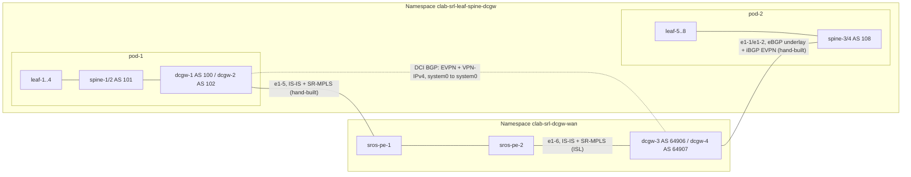

# Tech note: DCI underlay and overlay across the two namespaces (Talos #2)

Read from the live production objects and switches on 2026-11-02. The manifests are in
`clab/split-ns/`, and `clab/split-ns/README.md` has the rebuild procedure. This note explains what each
piece does and which pieces EDA does not build for you.

## 1. The two halves

One containerlab, onboarded into two EDA namespaces:

| Namespace | What lives there | How the DCGWs attach |
|-----------|------------------|----------------------|
| `clab-srl-leaf-spine-dcgw` | Fabrics `pod-1` (DC1) and `pod-2` (DC2): srl-leaf-1..8, srl-spine-1..4, dcgw-1/2. **All the VNETs.** | dcgw-1/2 are **border leaves of Fabric pod-1** (integrated model). The Fabric builds their DC-side BGP. |
| `clab-srl-dcgw-wan` | Fabric `backbone-simulation`: sros-pe-1/2, plus dcgw-3/4 | dcgw-3/4 are **standalone**, in no Fabric. Everything towards pod-2 is built by hand. |

Two kinds of link need hand-built plumbing:
- **dcgw-1/2 to sros-pe-1** joins the DC1 gateways to the WAN IGP.
- **spine-3/4 to dcgw-3/4** joins pod-2 to its standalone gateways.

Both cross namespaces, so neither can be a TopoLink. Each end is an `Interface` plus a `DefaultInterface` in its own namespace, with a /31 chosen by hand that must match on both ends. EDA does not know the two ends are the same cable.

## 2. Underlay inside each DC (built by the Fabric)

| | pod-1 | pod-2 |
|---|---|---|
| Underlay | eBGP per ISL with BFD, ASNs from `asn-pool` (spines 101, dcgw-1 100, dcgw-2 102) | eBGP per ISL with BFD (spines 108) |
| Overlay | iBGP EVPN AS 65401. Spine-1/2 are route reflectors (cluster 1.1.1.1). Leaves **and dcgw-1/2** are clients | iBGP EVPN AS 65402. Spine-3/4 are route reflectors (cluster 1.1.1.2). Only the leaves are fabric clients |
| Border leaves | `role=dcgw,fabric=pod-1` (dcgw-1/2) | none |

So pod-1's gateways need nothing extra on the DC side. pod-2 has no border leaves, and section 4 builds its gateway attachment by hand.

## 3. WAN underlay: one IS-IS L2 domain with SR-MPLS

All six WAN-facing routers run **IS-IS level 2, area 49.0001, with SR-MPLS**. They form one domain even though there are three `DefaultISISInstance` objects:

| Instance object | Namespace | Nodes |
|-----------------|-----------|-------|
| `isis-instance-1` | pod NS | dcgw-1, dcgw-2 |
| `isis-instance-2` | WAN NS | dcgw-3, dcgw-4 |
| `isis-instance-backbone` | WAN NS | sros-pe-1, sros-pe-2 |

Each instance sets the same values: `levelCapability: L2`, IPv4, `segmentRouting.mpls` with `srgbLabelBlock: srgb-wan` (LabelBlock 18432–20431) and `nodeSIDIndexPool: sr-node-sid-pool`, and `tlvConfig.poi: true`.

IS-IS interfaces:

| Link | Built by | Namespace |
|------|----------|-----------|
| dcgw-1 e1-3 to dcgw-2 e1-3 | ISL `dcgw-1-to-dcgw-2` (IS-IS enabled) | pod |
| **dcgw-1 e1-5 to pe-1 1/1/c1/1, `192.168.210.0/31`** | **DefaultInterface + DefaultISISInterface, each end in its own NS, ipMTU 1486** | pod (`dcgw-1-e1-5-pe-1`) and WAN (`pe-1-c1-dcgw-1`) |
| **dcgw-2 e1-5 to pe-1 1/1/c2/1, `192.168.210.2/31`** | same | pod (`dcgw-2-e1-5-pe-1`) and WAN (`pe-1-c2-dcgw-2`) |
| pe-1 to pe-2 (c5, c6) | Fabric `backbone-simulation` (`underlayProtocol: ISIS`, links labelled `wan-interSwitch`) | WAN |
| dcgw-3 e1-6 / dcgw-4 e1-6 to pe-2 | ISLs `dcgw-3-to-pe-2`, `dcgw-4-to-pe-2` (same namespace, so these are TopoLinks) | WAN |
| dcgw-3 e1-3 to dcgw-4 e1-3 | ISL `dcgw-3-to-dcgw-4` | WAN |
| system0 on every DCGW and PE | DefaultISISInterface, passive | both |

The PEs run IS-IS and SR only. They have no BGP and act as P routers.

Because the domain spans two namespaces, the pools must not overlap:

| Pool | Pod NS | WAN NS |
|------|--------|--------|
| `systemipv4-pool` | `11.0.0.0/24` | `11.0.2.16/28` (PEs). dcgw-3 `11.0.2.3` and dcgw-4 `11.0.2.4` are set statically in their DefaultRouters |
| `ipv4-pool` (ISL /31s) | `12.0.0.0/16` | `12.1.0.0/16` |
| `sr-node-sid-pool` | index 1–64 | index 101–164 |

Check: `show network-instance default tunnel-table` on dcgw-1 lists `11.0.2.3/32` and `11.0.2.4/32` as `sr-isis` via `192.168.210.1` (pe-1). On dcgw-3 it lists `11.0.0.7/32` and `11.0.0.8/32` via pe-2.

IS-IS runs only on the WAN-facing interfaces. It is not redistributed into either fabric's BGP, so WAN loopbacks don't leak into the leaves. See `SRL-DCI-WAN-IGP-Tech-Note.md` section 4.

## 4. Attaching the standalone dcgw-3/4 to pod-2 (all hand-built)

dcgw-3/4 have a user `DefaultRouter` each (`router-dcgw-3` **AS 64906**, `router-dcgw-4` **AS 64907**, router-ID 11.0.2.3/.4). Both sit outside `asn-pool`, because the pool hands 106 to srl-leaf-4. The two must differ; section 7 explains why.

**Four cross-namespace /31s**, each with a DefaultInterface on both ends:

| Link | Spine end (pod NS) | DCGW end (WAN NS) |
|------|--------------------|-------------------|
| spine-3 e1-9 to dcgw-3 e1-1 | `192.168.220.0/31` | `.1` |
| spine-3 e1-10 to dcgw-4 e1-1 | `192.168.220.2/31` | `.3` |
| spine-4 e1-9 to dcgw-3 e1-2 | `192.168.220.4/31` | `.5` |
| spine-4 e1-10 to dcgw-4 e1-2 | `192.168.220.6/31` | `.7` |

**BGP, built as two sessions per spine-DCGW pair (16 DefaultBGPPeers in total, 8 per namespace):**

| Session | Spine side (pod NS) | DCGW side (WAN NS) |
|---------|---------------------|--------------------|
| **eBGP underlay**, interface /31, IPv4 unicast only, BFD | group `ebgp-standalone-dcgw-pod-2`, peer AS 64906; the two dcgw-4 peers override it with 64907. Peers `spine-N-dcgw-M-ebgp` | group `ebgp-underlay-pod-2`, peer AS 108. Peers `dcgw-M-spine-N-ebgp` |
| **iBGP EVPN overlay**, system0 to system0, EVPN only | group `ibgp-rr-standalone-dcgw-pod-2`: AS 65402, `client: true`, cluster 1.1.1.2. **dcgw-3/4 become route-reflector clients of the pod-2 spines.** Peers `spine-N-dcgw-M-ibgp` to 11.0.2.3/.4 | group `ibgp-overlay-pod-2`: local AS 65402 (overrides 64906/64907). Peers `dcgw-M-spine-N-ibgp` to 11.0.0.13/.14 |

**Underlay policies** keep the exchange down to loopbacks:

| Policy | Applied | Does |
|--------|---------|------|
| `spine-import-standalone-dcgw` | spine, import | Accept only `11.0.2.3/32` and `11.0.2.4/32` (PrefixSet `standalone-dcgw-pod-2-system`), reject the rest |
| `spine-export-standalone-dcgw` | spine, export | Accept the spine's own system /32 (PrefixSet `pod-system-host-routes`, 11.0.0.0/24 ge 32) and BGP-learnt routes (the pod-2 leaf loopbacks), reject the rest |
| `dcgw-import-from-pod-2` | DCGW, import | Accept only pod-2 system /32s (`pod-2-system-host-routes`) |
| `dcgw-export-to-pod-2` | DCGW, export | Accept only its own system /32 (`standalone-dcgw-system`) |

Live result: spine-3 receives 1 IPv4 route from each DCGW and sends it 6 (the pod-2 spine and leaf loopbacks). Each iBGP EVPN session is Established.

## 5. DCI control plane between the gateway pairs

| Peer | Group | Addressing | AS (per-peer override) | Families | Policies |
|------|-------|------------|------------------------|----------|----------|
| dcgw-1 to dcgw-3 (`dcgw-1-dcgw-3-bgp-peer` / `dcgw-3-dcgw-1-bgp-peer`) | `default-bgp-group-dc-1` / `-dc-2` | system0 to system0 (11.0.0.7 to 11.0.2.3), multihop 5 | 65401 to 65402 (eBGP) | EVPN + VPN-IPv4 (advertise IPv6 next-hops) | export `export-dc-N-routes-and-add-soo`, import `import-dci-services-dc-N`, next-hop-self |
| dcgw-2 to dcgw-4 | same | 11.0.0.8 to 11.0.2.4 | same | same | same |

The groups set local AS 1000 and peer AS 1001 (1001 and 1000 on the DC2 side). Those values never reach the wire, because each peer overrides them with 65401 and 65402.

The sessions are **pair-wise**: dcgw-1 to dcgw-3 and dcgw-2 to dcgw-4, with no cross sessions. Losing dcgw-3 therefore leaves dcgw-1 without a DCI peer. Reachability between the system IPs comes from the SR-ISIS tunnels in section 3.

**Loop-prevention policies** use TagSets `tag-10` and `tag-20` and CommunitySets `soo-1122` and `soo-2211` (`origin:65501:1122` / `:2211`):
- **`import-dci-services-dc-1`:** reject EVPN routes carrying `soo-1122`, then accept everything else and tag it `tag-10`. The dc-2 policy mirrors it with `soo-2211` and `tag-20`.
- **`export-dc-1-routes-and-add-soo`:** reject EVPN routes tagged `tag-20`. Add `soo-1122` to EVPN Type 2 routes tagged `tag-10`, and accept everything else.

On paper, dc-1 tags what it learns from DC2 as `tag-10` and then adds the dc-1 SOO to exactly those routes on export, while its own routes leave without an SOO. With only one DCI peer per gateway, the eBGP AS-path check already stops a route coming back, so these rules do little today. **Review them before adding cross sessions** (dcgw-1 to dcgw-4).

Defined in both namespaces but **not applied** on dcgw-1, dcgw-3 or spine-3: `export-wan-routes-only-dc-1/2`, `import-policy-dcgw-to-pe`, `reject-igp-to-fabric`. Policies, PrefixSets, CommunitySets and TagSets are namespaced objects, which is why each set exists twice.

## 6. Overlay services and how the gateways stitch them

The VNETs exist **only in the pod namespace**. Each gateway VRF or MAC-VRF has two BGP instances: instance 1 is EVPN-VXLAN towards the DC fabric, and instance 2 is towards the WAN over MPLS on SR-ISIS tunnels. The gateway re-originates routes between the two instances.

Interconnects pick their gateways with the TopoNode label `eda.nokia.com/dci=dc-1` or `dc-2`. Their `nodeSelectors` only match nodes in the interconnect's own namespace, so **DC2's interconnects live in the WAN namespace and reference the pod-namespace service across namespaces**:

| Object | Namespace | References | WAN control plane | Export RT | Import |
|--------|-----------|------------|-------------------|-----------|--------|
| `router-interconnect-vnet-1` (spoke) | pod | `router-1` | IPVPN, MPLS SR-ISIS, EVI 1000 | `target:1:100` | `target:1:101` |
| `router-interconnect-vnet-5` (spoke) | pod | `router-3` | IPVPN, EVI 1002 | `target:1:105` | `target:1:101` |
| `router-interconnect-vnet-2` (hub) | WAN | `router-2` in `clab-srl-leaf-spine-dcgw` | IPVPN, EVI 1000 | `target:1:101` | Policy `multi-rt-import`: accept CommunitySet `vpn-import-rts` (`target:1:100`, `target:1:105`, match Any), reject the rest |
| `bd-interconnect-vnet-3` | pod | `bd-3` | EVPN-MPLS with control word, EVI 110 | `target:1:300` | `target:1:301` |
| `bd-interconnect-vnet-4` | WAN | `bd-4` in `clab-srl-leaf-spine-dcgw` | EVPN-MPLS with control word, EVI 111 | `target:1:301` | `target:1:300` |

The hub-and-spoke route targets give spoke isolation: both spokes import only the hub's `target:1:101`. The hub RIC uses an import policy instead of `importTarget`, because one RIC can't use both (eda golden rule 3).

The BDIs set `routeDistinguisher: Auto` on **both** BGP instances. That gives both gateways in a pair the same RD and originating IP, so they never flood to each other. Without it, broadcast, unknown-unicast and multicast traffic loops over the WAN. Section 7 has the detail.

Don't create copies of vnet-2 or vnet-4 in the WAN namespace. An earlier build did; the copies had no interfaces and showed Unknown.

## 7. L2 DCI loop avoidance and gateway redundancy (best practice)

Read from the switches on 2026-11-03, before and after giving dcgw-4 its own AS.

**How the redundant pair avoids loops.** The BDIs don't use an RFC 9014 interconnect Ethernet Segment: each gateway shows 0 Ethernet Segments and no route type 1 or 4. They also need no shared loopback. With `routeDistinguisher: Auto` on both BGP instances, EDA gives both gateways in a pair the same RD and the same multicast (route type 3) originating IP: the lower system IP of the pair. The partner doesn't own that IP; it is only a route attribute. The BGP next-hop stays each gateway's own system IP, so traffic always lands on a real node.

| Pair | RD, DC side / WAN side | Originating IP | Next-hop |
|------|------------------------|----------------|----------|
| dcgw-1 / dcgw-2 (`bd-3`) | `11.0.0.7:104` / `11.0.0.7:110` | 11.0.0.7 | own system IP |
| dcgw-3 / dcgw-4 (`bd-4`) | `11.0.2.3:105` / `11.0.2.3:111` | 11.0.2.3 | own system IP |

Because both gateways advertise the same route, neither treats its partner as a flood destination. dcgw-1's flood lists hold only the local leaf on the VXLAN side and dcgw-3 on the MPLS side. Every receiver picks one of the two copies by BGP best path, so each broadcast, unknown-unicast or multicast frame takes one gateway in and one out. In effect it is active/standby, decided by best path rather than by designated-forwarder election.

**Backup path through the fabric.** Each gateway also passes the WAN-side L2 routes into its own fabric's route reflectors, so the partner learns a second copy. That copy is the backup if the partner's own DCI peer fails. The traffic still goes straight over the WAN SR-ISIS tunnel, because the next-hop is the remote gateway. The leaves drop these routes on route target (`keep-all-routes false`), and only the gateways use `target:1:300` / `target:1:301`. Keep those route targets out of every fabric VNET. Only the EVPN family is carried this way; L3 (VPN-IPv4) has no fabric backup and does not need one, because each gateway re-originates the type-5 routes on its own.

**Use a different AS on each gateway in a pair.** The backup copy carries the AS of the gateway that reflected it. If both gateways share an AS, the partner rejects the copy as an AS-path loop and the pair has no backup. A likely result, not tested by failover, is that when dcgw-1 fails, dcgw-3 has no DC1 routes but still wins the pod-2 multicast best path, so broadcast and ARP traffic from DC2 is dropped. dcgw-1/2 already differ (100 and 102 from `asn-pool`). dcgw-3/4 shared 64906 until 2026-11-03; dcgw-4 is now 64907 (transaction 135867), and dcgw-4 holds two valid backup copies of DC1's routes via spine-3/4.

The spines reflect only their best copy, and never back to the gateway it came from. So the gateway whose copy is currently best (dcgw-3, lower router ID) shows no standing backup. If its DCI peer fails, it withdraws its copy, the spines switch to the partner's copy, and it then learns that copy. Checks: `scripts/check-l2-dci-loop.sh`, `check-l2-dci-loop-routes.sh`, `check-l2-dci-backup-path.sh`, `verify-dcgw-distinct-as.sh`.

**Not an option: border leaves of `backbone-simulation`.** An IS-IS-underlay Fabric builds border-leaf DefaultRouters with no BGP, even with `borderLeafs.asnPool` set, so the hand-built pod-2 and DCI peers fail validation. EDA also rejects an eBGP overlay over an IS-IS underlay. A Fabric hands out a per-node AS only with an eBGP underlay, which here means a border leaf of `pod-2` in the pod namespace (dry-runs 135823, 135841 and 135842).

## 8. What EDA built versus what was added by hand

| Built by EDA from a Fabric or ISL | Added by hand |
|-----------------------------------|---------------|
| pod-1 and pod-2 underlay eBGP and overlay iBGP, including dcgw-1/2 as pod-1 border leaves | 6 cross-namespace /31s as 12 DefaultInterfaces |
| ISLs with IS-IS on dcgw-1 to dcgw-2, dcgw-3 to dcgw-4, dcgw-3/4 to pe-2 | DefaultISISInterfaces on dcgw-1/2 e1-5 and pe-1 c1/c2, plus passive system0 on every DCGW and PE |
| Fabric `backbone-simulation` (pe-1 to pe-2 IS-IS) | Three DefaultISISInstances with SR-MPLS, the LabelBlock `srgb-wan`, non-overlapping pools in both namespaces |
| Interconnect VRFs, MAC-VRFs and their WAN BGP instances | DefaultRouters for dcgw-3/4 (AS 64906 / 64907, static router IDs) |
| | 4 DefaultBGPGroups and 16 DefaultBGPPeers for the pod-2 attachment, and 4 underlay Policies with 4 PrefixSets |
| | 2 DCI DefaultBGPGroups and 4 DefaultBGPPeers (dcgw-1 to dcgw-3, dcgw-2 to dcgw-4, one per end) |
| | SOO/tag Policies, CommunitySets and TagSets in both namespaces, plus `multi-rt-import` and `vpn-import-rts` |
| | TopoNode labels `eda.nokia.com/dci=dc-1/dc-2` |

## 9. In branch-1 (branch twin on .62)

The cross-namespace cables cannot be simulated there. TopoLinks and SimLinks have no namespace field, and production has no TopoLink for these 6 cables anyway. After every Restore or Rebase, the branch shows:

| Object | State | Why |
|--------|-------|-----|
| 6 interfaces per namespace: pod NS spine-3/4 e1-9/e1-10 and dcgw-1/2 e1-5; WAN NS dcgw-3/4 e1-1/e1-2 and sros-pe-1 1/1/c1/1, 1/1/c2/1 | Down | No simulated cable |
| All 20 DefaultBGPPeers in sections 4 and 5 (10 per namespace) | NotEstablished | Underlay and DCI sessions ride those cables |
| DefaultRouters `router-dcgw-3/4` | Degraded | Their BGP peers are down |
| Fabrics `pod-1`, `pod-2`, `backbone-simulation` | Degraded | Down interfaces and IS-IS adjacencies |
| DCI VNETs and interconnects | show Up | Their local parts are Up. **Cross-DC traffic cannot flow in the branch** |
| `fw-*` VNETs | Degraded | Unrelated to DCI: the firewall BGP peer is a real VM that the branch does not simulate |

The branch is good for reviewing intent and config diffs, and for testing inside each DC. It cannot prove DCI end to end. That needs either Nokia support for simulated links across namespaces, or a branch-only layout with all DCI nodes in one namespace.

## 10. Validation (production)

- `scripts/validate-dci-split.sh`: 9 checks. Exit code equals the number of failed checks.
- On a DCGW: `show network-instance default protocols isis adjacency`, `show network-instance default tunnel-table` (rows must be `sr-isis`), and `show network-instance default protocols bgp neighbor` (DCI peer Established with `evpn` and `l3vpn-ipv4-unicast`).
- On spine-3/4: the `ebgp-standalone-` and `ibgp-rr-standalone-` neighbors Established.
- Isolation between projects: `eda-fw-integration/scripts/fw-vni-audit.sh` (0 collisions) and eda golden rule 21. Use explicit EVI and VNI values; the DCI VNETs own EVI 100–109 and VNI 200–209.
